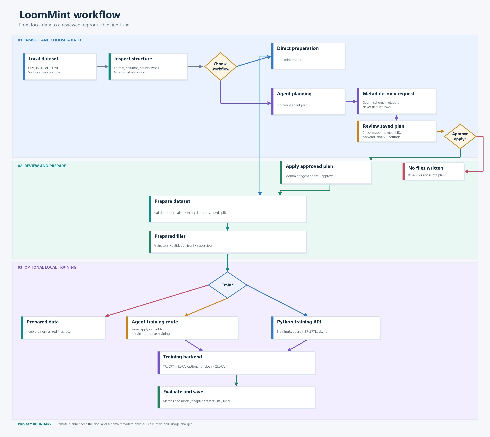

# LoomMint

LoomMint is a local-first toolkit for preparing supervised fine-tuning data and running open-model SFT jobs. Its bounded planner can propose a dataset mapping and training plan from metadata; local validation and explicit approval control preparation and training. It does not generate or execute code.

## Why the name LoomMint?

“Loom” evokes weaving the dataset, model, and training configuration into a repeatable workflow. “Mint” evokes crafting a task-adapted model from open weights. Together, LoomMint describes turning separate fine-tuning steps into one understandable, reviewable process.

2## What LoomMint does

- Inspects local CSV, JSON, and JSONL datasets without displaying row contents.
- Detects `messages`, ShareGPT `conversations`, Alpaca instruction/input/output, prompt/completion, and question/answer layouts.
- Converts supported records to canonical conversational JSONL with a `messages` field.
- Rejects ambiguous, mixed, malformed, or assistant-less records rather than silently guessing or dropping them.
- Removes exact duplicate conversations, creates a seeded train/validation split, and writes a report without example contents.
- Optionally asks an AI planner to propose a format, field mapping, model ID, backend, and SFT settings from dataset metadata.
- Runs supervised fine-tuning through TRL SFT + LoRA, with optional Unsloth model loading and QLoRA.

Raw documents do not contain reliable instruction/answer labels by themselves, so LoomMint does not synthesize labels. It does not detect or remove personal information. Review data rights, sensitive content, model licenses, chat templates, and target modules before training.

## Workflow at a glance




Direct preparation and Python API training are local. In the agent-assisted path, planning does not write files and `apply` requires `--approve`. To train during that same apply invocation, also pass `--train`, `--approve-training`, and `--training-output-dir`. Remote planners receive the goal and dataset metadata (row count, column names, observed types, missing counts, and detected format), not row contents. Do not include private examples or secrets in the goal.

## Requirements

- Python 3.11–3.13.
- The inspection and preparation core has no third-party runtime dependencies.
- Training requires a compatible PyTorch build and accelerator setup; TRL/PEFT or Unsloth dependencies are optional extras.

## Install from a source checkout

Run these commands from the repository root. The Windows commands below use Command Prompt; the Ubuntu commands use Bash.

**Windows**

```bat
py -3.12 -m venv .venv
.venv\Scripts\activate.bat
python -m pip install -e .
```

**Ubuntu**

```bash
python3.12 -m venv .venv
source .venv/bin/activate
python -m pip install -e .
```

If `py -3.12` or `python3.12` is unavailable, use the command for another supported Python 3.11–3.13 installation.

## Inspect and prepare data

For a quick check, save these two synthetic records as `data/sample.jsonl`:

```jsonl
{"messages":[{"role":"user","content":"What is photosynthesis?"},{"role":"assistant","content":"Plants use sunlight to turn water and carbon dioxide into sugars and oxygen."}]}
{"messages":[{"role":"user","content":"What is evaporation?"},{"role":"assistant","content":"Evaporation is the change from liquid water to water vapor."}]}
```

Inspect reports structure, not row values.

**Windows**

```bat
if not exist data mkdir data
loommint inspect data\sample.jsonl
loommint prepare data\sample.jsonl --output-dir prepared\sample
```

**Ubuntu**

```bash
mkdir -p data
loommint inspect data/sample.jsonl
loommint prepare data/sample.jsonl --output-dir prepared/sample
```

Preparation writes `train.jsonl`, `validation.jsonl`, and `report.json`. It refuses to overwrite existing output files. The split is deterministic for a given seed. If automatic format detection is ambiguous, review the input and select `--format` explicitly.

## Agent-assisted planning

The default planner is OpenAI `gpt-6-luna` at `https://api.openai.com/v1`. The model currently lists standard short-context pricing of $0.10 per 1M input tokens and $0.50 per 1M output tokens; API usage may incur charges. Other OpenAI-compatible endpoints can be configured, but remote endpoints must use HTTPS.

Copy `.env.example` to `.env` from the repository root, then set `LOOMMINT_AGENT_API_KEY` in that file using your local editor. `.env` is gitignored. Process environment variables take precedence. Never paste the key into source control or chat.

**Windows**

```bat
copy .env.example .env
loommint agent plan data\sample.jsonl --goal "Prepare this synthetic question-answer dataset for SFT" --plan-file sample.plan.json
```

**Ubuntu**

```bash
cp .env.example .env
loommint agent plan data/sample.jsonl --goal "Prepare this synthetic question-answer dataset for SFT" --plan-file sample.plan.json
```

The planner may return `needs_information` rather than guess. Verify the proposed model ID, access, license, tokenizer chat template, LoRA target modules, and training settings yourself. A plan contains the local source path and a SHA-256 fingerprint. Applying it checks that the source has not changed.

Apply the reviewed plan only after explicit approval:

**Windows**

```bat
loommint agent apply sample.plan.json --output-dir prepared\sample --approve
```

**Ubuntu**

```bash
loommint agent apply sample.plan.json --output-dir prepared/sample --approve
```

To also train, provide the separate training approval:

**Windows**

```bat
loommint agent apply sample.plan.json --output-dir prepared\sample --approve --train --approve-training --training-output-dir outputs\sample
```

**Ubuntu**

```bash
loommint agent apply sample.plan.json --output-dir prepared/sample --approve --train --approve-training --training-output-dir outputs/sample
```

## Training through the Python API

Install the TRL training dependencies first:

**Windows and Ubuntu**

```text
python -m pip install -e ".[trl]"
```

For the optional Unsloth path, install `.[unsloth]` instead. The model must have a compatible chat template and the configured LoRA target modules must exist in its architecture.

```python
from pathlib import Path

from loommint.trainers import TrainingRequest
from loommint.trl_backend import TRLSFTBackend

request = TrainingRequest(
    model_id="HuggingFaceTB/SmolLM2-135M-Instruct",
    train_file=Path("prepared/sample/train.jsonl"),
    validation_file=Path("prepared/sample/validation.jsonl"),
    output_dir=Path("outputs/sample"),
    parameters={"num_train_epochs": 1, "max_length": 256},
)
result = TRLSFTBackend().train(request)
print(result.metrics)
```

## Local smoke verification

A one-epoch TRL SFT + LoRA run completed locally with cached `HuggingFaceTB/SmolLM2-135M-Instruct` weights, a six-conversation synthetic dataset, and an RTX 5060 Laptop GPU. It produced training and evaluation metrics and saved adapter artifacts. These small-data results verify the execution path only; they are not quality or generalization evidence. The Unsloth/QLoRA backend has not yet had a real hardware run.

## Development checks

**Windows and Ubuntu**

```text
python -m unittest discover -s tests -v
python -c "from pathlib import Path; import py_compile; [py_compile.compile(str(path), doraise=True) for path in Path('src/loommint').glob('*.py')]; py_compile.compile('tests/test_loommint.py', doraise=True)"
python -m pip wheel --no-deps --wheel-dir dist .
```

The GitHub Actions workflow runs tests, compilation, and a wheel build on Windows and Ubuntu with Python 3.11, 3.12, and 3.13. See `ARCHITECTURE.md` for the detailed architecture and smoke-test record, and `MASTER_TEST_CASES.md` for the regression inventory.
